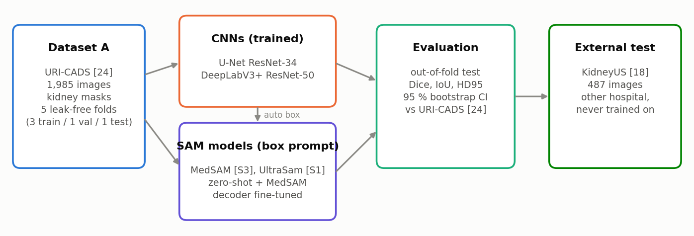
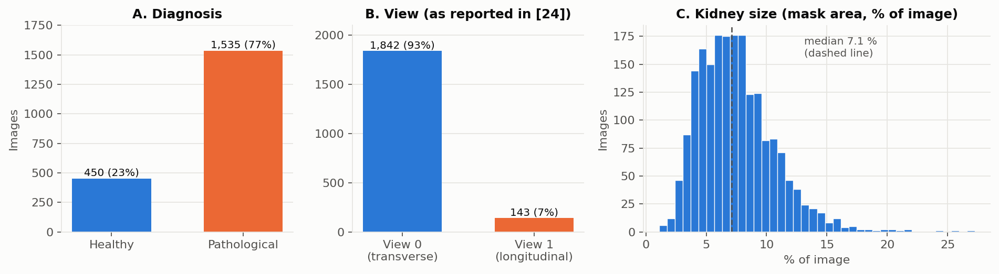
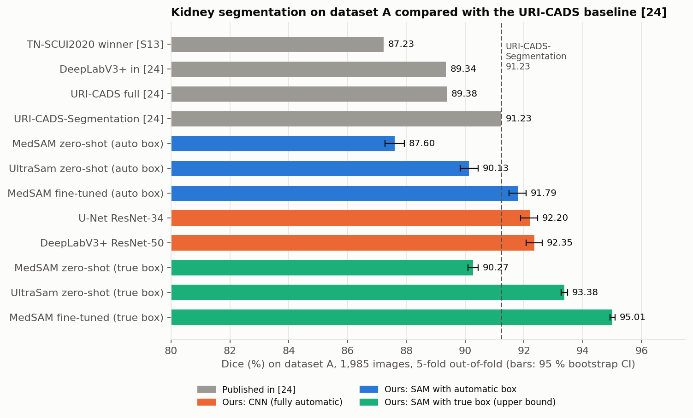
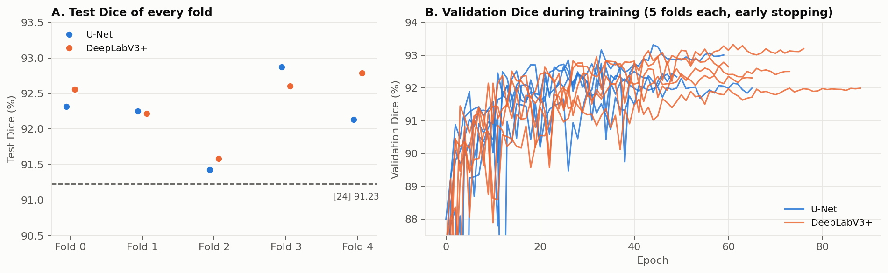
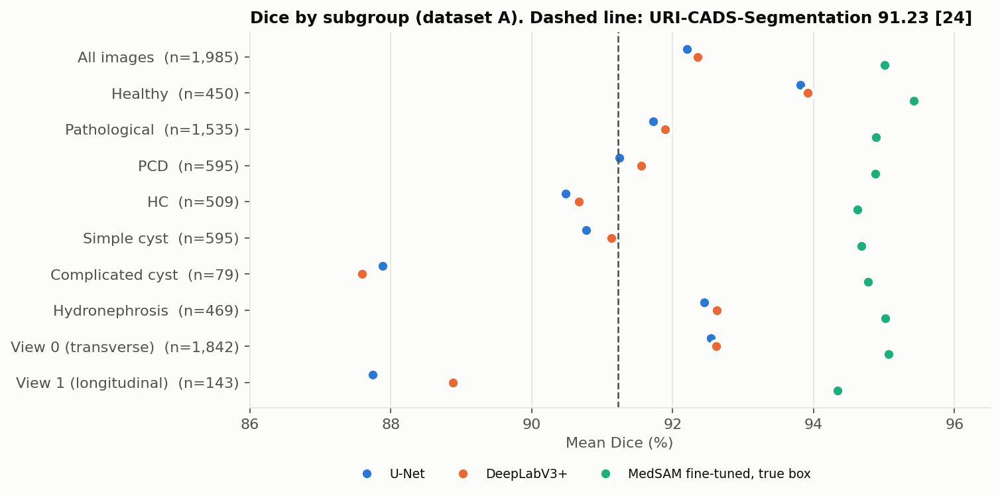
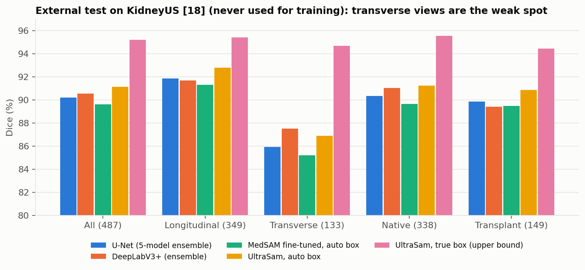
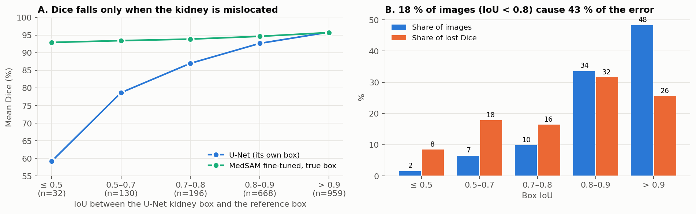
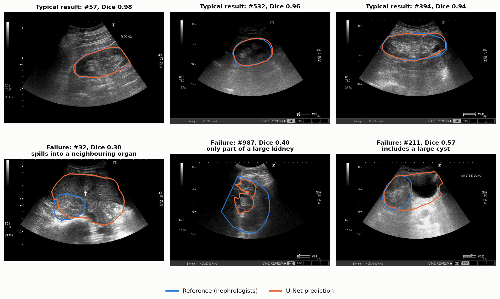

# Automatic Kidney Segmentation in Renal Ultrasound: Phase 2 Report

**Project:** Deep learning for kidney ultrasound classification in primary care
**Phase:** 2 of 3. Kidney segmentation, the first stage of the diagnosis pipeline
**Date:** 26 October 2026
**Code and full results:** branch `segmentation` (`src/kidney/`, `report.md`, `results/`)

---

## Abstract

Primary-care professionals can acquire kidney ultrasound images but often lack the experience to interpret them. Our project builds a
deep-learning pipeline that first **finds the kidney** and then **classifies it** as healthy or pathological. This report covers the
first stage, kidney segmentation.

We trained and compared seven approaches on the public URI-CADS dataset (1,985 images, Hospital Ramón y Cajal) [24]. We used a leak-free
5-fold cross-validation that keeps near-duplicate images in the same fold. Two convolutional networks, **U-Net (Dice 92.20 %)** and
**DeepLabV3+ (92.35 %)**, both **outperform the published URI-CADS segmentation model (91.23 %)**, with narrow 95 % confidence intervals
that exclude the baseline. Ultrasound foundation models (MedSAM, UltraSam) reach up to 95.0 % when given the correct kidney box. On an
independent dataset from another hospital (KidneyUS, 487 images) [18], never used in training, the models keep a Dice of about 90 %.

The error analysis shows that the remaining errors come from **locating** the kidney, not from **outlining** it. This points to the
"detect first, then segment" design of the baseline as the next step.

---

## 1. Introduction

Ultrasound is cheap, portable and radiation-free, which makes it attractive for primary care. Interpreting renal ultrasound needs
experience, so images are often referred to nephrology, adding to the specialists' workload [1, 2]. A reliable automatic system could
help triage these referrals.

Our pipeline has three phases:

1. **Data integrity**: verify annotations, detect near-duplicates and build a leak-free split (completed).
2. **Kidney segmentation**: outline the kidney automatically (**this report**).
3. **Classification**: healthy vs pathological, and the main pathologies, using the kidney region found in Phase 2.

Segmentation matters for classification because almost every lesion lies inside the kidney (Section 2), so the classifier can focus on
the kidney region instead of the whole image.

**Baseline.** We compare against **URI-CADS** [24], a multi-task network (Mask R-CNN + ResNet-50) published with the same dataset. Its
segmentation-only version reports **Dice 91.23 % / IoU 84.99 %**, and its full system 89.38 % / 81.41 %.

**Questions of this phase:**
- Can standard segmentation networks match or beat the URI-CADS baseline on the same data?
- Do recent foundation models for medical / ultrasound images help?
- Do the models generalise to images from another hospital?

**Figure 1.** Study design. All models are trained and tested with the same five folds. KidneyUS is an external test only.

## 2. Data

**Figure 2.** Dataset A (URI-CADS [24]). **A.** 77 % of images are pathological. **B.** 93 % of images are in one view (View 0,
transverse according to [24]). **C.** The kidney is small: a median 7.1 % of the image.

**Dataset A (URI-CADS [24])**: 1,985 B-mode images, one per patient, Toshiba Xario 660a, 2009–2018, annotated by two nephrologists.
Each image has a kidney outline (a polygon drawn over an ellipse), global pathology flags (poor corticomedullary distinction, PCD, 595
images; hyperechoic cortex, HC, 509 images) and lesion boxes (2,478 boxes on 1,323 images: cysts, hydronephrosis, stones and others).

Data checks:
- All 1,985 masks match their image size. 6 masks have more than one part and 2 have holes.
- **98.7 % of the lesion-box centres lie inside the kidney mask**, so cropping to the kidney loses almost no lesion.
- 87 groups of near-duplicate images (180 images) were found in Phase 1. Each group is kept inside one fold, so a copy of a test image is
  never used in training.

**Dataset B (KidneyUS [18])**: an open dataset from another hospital, with several scanners and kidney capsule outlines traced by
sonographers. 487 images with a usable outline (349 longitudinal, 133 transverse; 338 native and 149 transplant kidneys). **Used only as an
external test**, never for training or tuning.

## 3. Methods

**Validation protocol.** 5-fold cross-validation with the same scheme as [24]: in repetition *k*, fold *k* is the test set, fold *k*+1 the
validation set (used for early stopping) and the other three folds the training set. Every image is tested exactly once, by a model that
never saw it. Folds are stratified by diagnosis (77.3–77.4 % pathological in every fold) and keep near-duplicates together.

**Models.**

| Model | Type | Training |
|---|---|---|
| U-Net with ResNet-34 encoder | CNN, dense segmentation | trained on our folds (ImageNet start) |
| DeepLabV3+ with ResNet-50 encoder | CNN, dense segmentation | trained on our folds (ImageNet start) |
| MedSAM [S3] | foundation model, box prompt | none (zero-shot) |
| UltraSam [S1] | ultrasound foundation model, box prompt | none (zero-shot) |
| MedSAM, decoder fine-tuned | foundation model, box prompt | mask decoder fine-tuned on our folds |

Box-prompted models need a box around the kidney. We test two kinds:
- **Automatic box**, taken from the U-Net prediction. The pipeline is fully automatic.
- **True box**, taken from the reference mask. This is an upper bound, not a clinical setting.

**Training details (CNNs).** 512-pixel input, Dice + cross-entropy loss, AdamW optimiser with a cosine schedule, up to 100 epochs with early
stopping on validation Dice. Augmentation follows [24] (rotation, gamma, translation, zoom), plus mild Gaussian noise. Post-processing
keeps the largest region and fills holes.

**Metrics.** Dice and IoU (as in [24]), and HD95 (boundary distance in pixels), all computed at the original image resolution. We report the
mean ± SD over the 5 test folds and a 95 % bootstrap confidence interval over the 1,985 images.

## 4. Results

### 4.1 Comparison with the URI-CADS baseline

**Figure 3.** Dice on dataset A. Grey: results published in [24]. Our results are shown with 95 % confidence intervals. Dashed line:
URI-CADS-Segmentation (91.23 %).

| Model | Dice (%) | IoU (%) | HD95 (px) | vs [24] (Dice) |
|---|---|---|---|---|
| DeepLabV3+ in [24] | 89.34 | 81.80 | n.r. | −1.89 |
| URI-CADS full system [24] | 89.38 | 81.41 | n.r. | −1.85 |
| **URI-CADS-Segmentation [24] (baseline)** | **91.23** | **84.99** | n.r. | – |
| **Our U-Net ResNet-34** | **92.20 ± 0.52** | **86.16 ± 0.79** | 20.7 ± 1.2 | **+0.97** |
| **Our DeepLabV3+ ResNet-50** | **92.35 ± 0.48** | **86.39 ± 0.64** | 20.0 ± 1.1 | **+1.12** |
| MedSAM zero-shot, automatic box | 87.60 ± 0.35 | 78.63 ± 0.49 | 27.9 ± 0.7 | −3.63 |
| UltraSam zero-shot, automatic box | 90.13 ± 0.42 | 82.64 ± 0.62 | 23.0 ± 1.1 | −1.10 |
| MedSAM fine-tuned, automatic box | 91.79 ± 0.40 | 85.47 ± 0.59 | 20.7 ± 1.2 | +0.56 |
| *UltraSam zero-shot, true box (upper bound)* | *93.38 ± 0.14* | *87.68 ± 0.24* | *14.6 ± 0.4* | *+2.15* |
| *MedSAM fine-tuned, true box (upper bound)* | *95.01 ± 0.08* | *90.57 ± 0.14* | *11.8 ± 0.2* | *+3.78* |

n.r. = not reported.

Key findings:
- **Both CNNs beat the baseline.** The baseline value (91.23) lies below the lower end of both 95 % confidence intervals (U-Net 91.89–92.47,
  DeepLabV3+ 92.07–92.63).
- **Same architecture, better training.** [24] reported 89.34 for DeepLabV3+; our DeepLabV3+ reaches 92.35 on the same images (+3.0). [24]
  concluded that a "detect, then segment" design is needed; a well-trained dense network is already enough to beat it.
- **Foundation models depend on the box.** With the true box they are the most accurate models. With the automatic box they are no better
  than the U-Net that produced the box.

### 4.2 Stability across folds and training

**Figure 4.** **A.** Every one of the 10 CNN test folds is above the baseline (lowest: 91.43). **B.** Validation Dice during training.
Early stopping picks the best epoch (U-Net: epochs 26–50; DeepLabV3+: epochs 45–73).

The results are stable: the fold-to-fold SD is about 0.5 Dice points. U-Net and DeepLabV3+ are within each other's confidence interval,
and U-Net trains about 30 % faster (about 30 vs 44 minutes per fold on one laptop GPU).

### 4.3 Which images are hard?

**Figure 5.** Mean Dice by subgroup. Blue / orange: the automatic CNNs. Green: MedSAM fine-tuned with the true box.

- **Healthy kidneys** are easier (about 93.8) than pathological ones (about 91.8).
- **Low-contrast kidneys**, hyperechoic cortex (HC, about 90.5) and PCD (about 91.4), are harder. [24] reports the same weakness. Even on these
  images our CNNs score above the overall result of the DeepLabV3+ in [24].
- **Complicated cysts** (about 87.7) are the hardest pathology: the model must decide whether a large cyst belongs to the kidney.
- **The rare view** (View 1, 7 % of images) is 4–5 points worse for every automatic model, but **not** when the true box is given (94.3).

### 4.4 External test on another hospital (KidneyUS)

**Figure 6.** Dice on KidneyUS [18], which was never used for training.

| Model | Dice, all 487 images | Longitudinal | Transverse |
|---|---|---|---|
| U-Net, 5-model ensemble | 0.902 | 0.919 | 0.859 |
| DeepLabV3+, 5-model ensemble | 0.905 | 0.917 | 0.875 |
| UltraSam, automatic box | **0.911** | 0.928 | 0.869 |
| UltraSam, true box (upper bound) | 0.952 | 0.954 | 0.947 |

- **The models generalise:** on a different hospital, scanner and annotation style, Dice drops by only about 2 points.
  [24] reports no external test.
- **Averaging the 5 fold models** (ensemble) adds about 1 point over a single model.
- **UltraSam**, pretrained on ultrasound only, is the most robust model with an automatic box.
- **Transverse views** are the weak spot, but the gap disappears with the true box. As on dataset A, the problem is finding the kidney.

## 5. Error analysis: locating vs outlining

**Figure 7.** Images grouped by how well the U-Net kidney box overlaps the reference box (box IoU). **A.** When the box is right
(IoU > 0.9), the U-Net is as good as the best upper bound (95.9). With a poor box, Dice collapses, while the same images reach about 93 with
the true box. **B.** The 18 % of images with box IoU < 0.8 cause 43 % of all the lost Dice.

**Figure 8.** Examples (blue: nephrologists' reference; orange: U-Net). Top: typical results. Bottom: the three kinds of failure. The model
spreads into a neighbouring organ, finds only part of a large kidney, or includes a large cyst that the reference leaves out.

We also tested forcing the predicted masks into a regular shape (ellipse or convex hull), because the reference masks are drawn over an
ellipse. This did not help: our masks are already convex, and an ellipse costs about 1 point. **The outline quality is not the problem; the
location and extent of the kidney are.**

## 6. Discussion

**Comparison with the baseline.** Our fully automatic networks outperform the URI-CADS segmentation model [24] on the same data and with
the same 3/1/1 fold scheme. Our split is at least as strict, because near-duplicates are kept out of the test fold, which [24] does not
mention. We also report what [24] does not: boundary distance (HD95), variation across folds, confidence intervals and an external test.

**What [24] got right.** The main remaining error is localisation: which structure is the kidney and where it ends. The key idea of [24] is
to detect the kidney first; its detector missed only one kidney in the whole dataset. Our analysis suggests that combining a good detector
with our fine-tuned box-prompted model could approach the 95 % upper bound.

**What should not be copied from [24].** In [24], adding the diagnosis branches to the segmentation network lowered segmentation Dice
(91.23 → 89.38). Multi-task learning belongs in the classification phase, not in the segmentation model.

**Limitations.**
- The comparison with [24] uses its published summary numbers only. Per-image results are not available, so no paired statistical test is
  possible.
- One training run per configuration (fixed seed). The SD reflects data splits, not training randomness.
- HD95 is in pixels, and pixel size differs between scanners.
- The meaning of the view labels in dataset A is taken from [24] and is not documented in the label files.

## 7. Conclusions

1. Standard segmentation networks, well trained, **beat the published URI-CADS baseline**: Dice 92.20 % (U-Net) and 92.35 % (DeepLabV3+)
   vs 91.23 %.
2. The models **generalise to another hospital** (Dice ≈ 90 % on KidneyUS without any adaptation).
3. **Remaining errors come from locating the kidney**, especially in the rare view and in kidneys next to large cysts or other organs.
4. The U-Net is recommended as the kidney model for the classification phase. A kidney box is already available for every image.

## 8. Future work

**Phase 2, improvement round**, following the detect-then-segment idea of [24]:

| Step | What | Goal |
|---|---|---|
| R1 | Train a dedicated kidney detector (Faster R-CNN ResNet-50, as in [24]) | more accurate kidney boxes than the U-Net (now 18 % of images with box IoU < 0.8) |
| R2 | Detector box → fine-tuned MedSAM | close the gap between 92.2 (now) and 95.0 (true-box upper bound) |
| R3 | Fine-tune UltraSam [S1] in the same way | best second stage, especially on the external test |
| R4 | More augmentation and oversampling of the rare view for the detector | fix the weak view |

All experiments keep the same folds, are compared image by image with the current U-Net, and keep KidneyUS as an external test only.

**Phase 3, classification (main goal).** Classify kidney crops from Phase 2. Targets from [24]: healthy vs pathological **AUC 87.41 %,
specificity at 95 % sensitivity 60.59 %**; multi-class average AUC 81.90 %. Before this phase we must:
- handle the class imbalance (450 healthy vs 1,535 pathological);
- resolve the 31 near-duplicate groups with inconsistent labels;
- make sure the classifier cannot read the diagnosis text printed on some images (e.g. "QUISTE").

---

## References

Numbering follows the team reference list (`Documents/references.md`) and literature review (`Documents/kidney_ultrasound_DL_review.docx`).

- **[1]** Deep learning in renal ultrasound: applications, challenges, and future outlook. *Front Oncol* 2025.
  doi:10.3389/fonc.2025.1730628
- **[2]** A narrative review on the application of artificial intelligence in renal ultrasound. *Front Oncol* 2024.
  doi:10.3389/fonc.2023.1252630
- **[18]** Singla R, Ringstrom C, Hu G, Lessoway V, Reid J, Nguan C, Rohling R. The Open Kidney Ultrasound Data Set. *arXiv* 2206.06657, 2022;
  ASMUS 2023, LNCS, pp. 155–164, Springer.
- **[24]** Molina-Moreno M, González-Díaz I, Rivera Gorrín M, Burguera Vion V, Díaz-de-María F. URI-CADS: A fully automated
  computer-aided diagnosis system for ultrasound renal imaging. *Journal of Imaging Informatics in Medicine*, 2024.
  doi:10.1007/s10278-024-01055-4. Code and data: https://github.com/miguel55/URI-CADS
- **[S1]** Meyer A, Murali A, Zarin F, Mutter D, Padoy N. UltraSam: A foundation model for ultrasound using large open-access
  segmentation datasets. arXiv:2411.16222, 2024.
- **[S3]** Ma J, He Y, Li F, Han L, You C, Wang B. Segment anything in medical images (MedSAM). *Nature Communications* 15:654, 2024.
  doi:10.1038/s41467-024-44824-z
- **[S13]** Wang M. 1st place solution for the TN-SCUI 2020 challenge (thyroid nodule segmentation and classification).
  https://github.com/WAMAWAMA/TNSCUI2020-Seg-Rank1st

Methods: U-Net (Ronneberger et al., MICCAI 2015); DeepLabV3+ (Chen et al., ECCV 2018); ResNet (He et al., CVPR 2016); Segment Anything
(Kirillov et al., ICCV 2023); Mask R-CNN / Faster R-CNN (He et al., ICCV 2017); AdamW (Loshchilov & Hutter, ICLR 2019); bootstrap CI
(Efron & Tibshirani, 1993). The full list is in `report.md` on branch `segmentation`.

*Figures can be regenerated with `PYTHONPATH=src python scripts/make_figures.py` (branch `segmentation`).*
